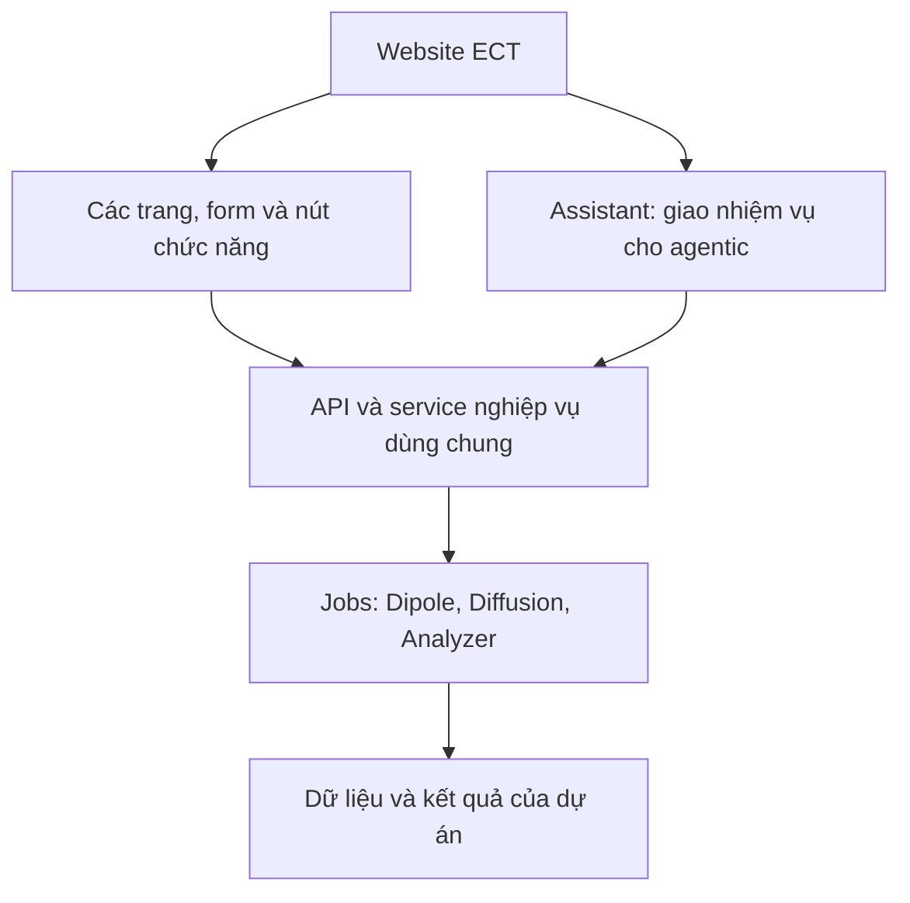
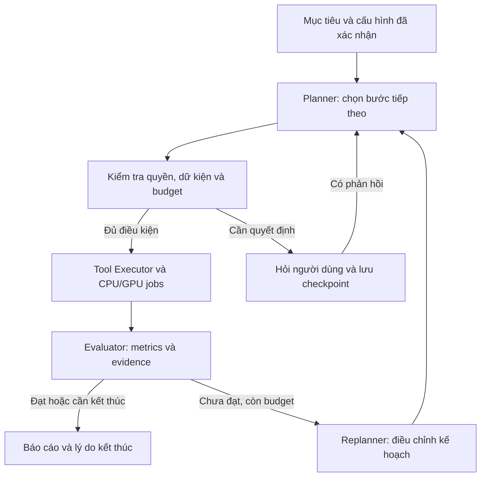
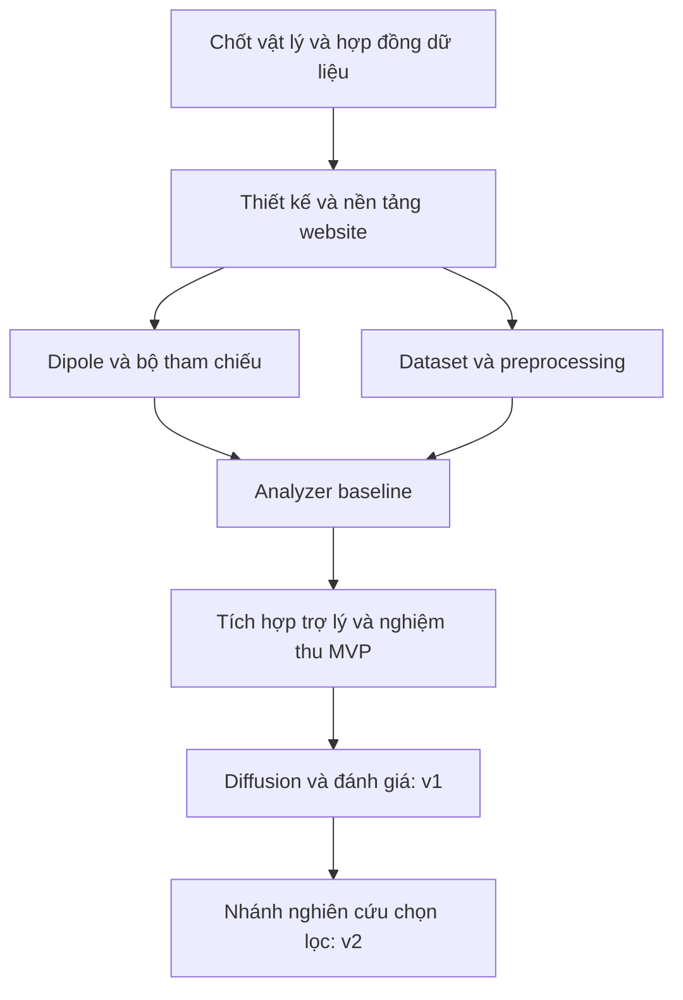

# KẾ HOẠCH WEBSITE ECT TÍCH HỢP TRỢ LÝ AGENTIC

Ngày lập: 22/10/2026. Căn cứ: readme.md trong thư mục DATN và yêu cầu làm rõ của người dùng: một website thông thường có tích hợp agentic software.

Tài liệu này là kế hoạch thực hiện yêu cầu trong README: chuẩn bị tài liệu thiết kế phần mềm, xây dựng MVP và mở rộng đủ ba mảng dipole, diffusion, crack analysis. Các quyết định dưới đây là đề xuất để bắt đầu; chưa phải kết quả kiểm chứng mô hình hoặc đặc tả cuối cùng.

## 1. Mục tiêu, giả định và cách chia phạm vi

Mục tiêu: xây dựng website ECT có các trang quản lý dự án, dữ liệu, mô phỏng dipole, sinh dữ liệu diffusion, phân tích vết nứt và báo cáo. Người dùng thao tác trực tiếp qua menu, form, bảng và nút chức năng. Website tích hợp thêm trợ lý agentic để người dùng giao mục tiêu và tự động hóa chuỗi công việc khi cần. Các màn hình chức năng và trợ lý cùng sử dụng lớp nghiệp vụ/API, mô hình tính toán, dữ liệu và hệ thống job. Mỗi kết quả phải truy được dữ liệu, tham số, phiên bản mô hình và lần chạy tạo ra nó.

Nguyên tắc trải nghiệm đã xác nhận: các chức năng nghiệp vụ trong phạm vi từng phiên bản phải sử dụng đầy đủ qua giao diện thông thường. Trợ lý là lựa chọn bổ sung trên website; chỉ bắt đầu lập kế hoạch và thực thi khi người dùng giao nhiệm vụ. Khi tắt trợ lý hoặc dịch vụ LLM của trợ lý không khả dụng, các chức năng trực tiếp vẫn hoạt động nếu backend, worker và mô hình tương ứng còn khả dụng.

Thông tin đã có: tấm Al7075 dày 5 mm; dãy Hall 32 × 32, pitch 0,78 mm; các tần số 5/10/20 kHz; CSV chứa hiệu giữa các sensor kề nhau; năm biên dạng Rectangular, Triangular, Ellipse, Step_R, Step_T.

Thông tin chưa có: công thức/source dipole, dữ liệu CSV mẫu, nhãn ground truth, checkpoint, cấu hình GPU, deadline, nhân sự và ngân sách. Qua kiểm tra ban đầu, thư mục dự án hiện chỉ có readme.md.

Giả định để lập lịch: một người triển khai khoảng 25 giờ/tuần, có người hướng dẫn xác nhận mô hình vật lý và có quyền sử dụng dữ liệu. Thời gian thu thập dữ liệu mới, mua thiết bị hoặc xây dựng FEM từ đầu chưa nằm trong ước lượng.

| Mốc | Phạm vi đề xuất | Đầu ra có thể nghiệm thu |
| --- | --- | --- |
| Thiết kế | Làm rõ vật lý/dữ liệu; hoàn thiện 9 phần tài liệu theo README | Một tài liệu thiết kế .docx, sơ đồ và mã nguồn sơ đồ, danh sách giả định và quyết định |
| MVP | Website thao tác trực tiếp: dipole, upload CSV, baseline phân tích, báo cáo, lịch sử; tích hợp trợ lý agentic cho chuỗi tác vụ giới hạn | Demo thao tác trực tiếp và demo giao việc cho trợ lý, dùng chung kết quả và truy vết |
| v1 | Conditional diffusion; đánh giá augmentation; sweep; so sánh nguồn đo/mô phỏng; hoàn thiện năm biên dạng | Bản tích hợp đủ ba mảng chính của đề tài, kèm đánh giá định lượng |
| v2 | PINN, super-resolution, FEM tự động, active learning, explainability nâng cao | Các thử nghiệm mở rộng có báo cáo lợi ích và giới hạn |

MVP là mốc kiểm tra sớm. Nếu tiêu chí bảo vệ yêu cầu cả ba mảng, mốc hoàn thành phải là cuối v1. Hỗ trợ năm biên dạng được thiết kế ngay từ đầu; chỉ công bố một biên dạng là hoạt động khi đã có định nghĩa hình học và kiểm chứng tương ứng.

## 2. Những việc phải chốt trước khi lập trình mô hình

### 2.1. Chốt hợp đồng dữ liệu

- Lấy CSV đại diện cho từng kiểu đo; ghi rõ hàng/cột, trục x/y/z, đơn vị, thứ tự sensor, chiều lấy hiệu và cách xử lý sensor lỗi.
- Xác định giá trị là Bz, delta-Bz, điện áp, ADC, phần thực/ảo hay biên độ/pha. Chỉ đổi sang đơn vị từ trường khi có thông tin hiệu chuẩn.
- Nếu lấy hiệu theo x trên lưới 32 × 32, kết quả thường là 32 × 31; theo y là 31 × 32. Đây là suy luận từ phép sai phân, cần đối chiếu định dạng thực tế; không tự ép mọi file thành 32 × 32.
- Phân biệt hiệu delta-Bz với gradient delta-Bz/pitch. Lưu toán tử đo, dấu, tọa độ đầu ra và quy ước biên để áp dụng nhất quán cho dữ liệu mô phỏng.
- Giữ file gốc bất biến. Tách dữ liệu số, dữ liệu đã tiền xử lý và ảnh heatmap để tránh huấn luyện từ màu của ảnh hiển thị.
- Mỗi mẫu có specimen_id, acquisition_id, source_type, frequency_hz, sensor_geometry, measurement_operator, unit, calibration_version và nhãn W/L/D nếu có.
- source_type phân biệt measured, dipole, FEM, diffusion. Nhãn chưa biết phải để trống và có trạng thái rõ ràng.

### 2.2. Chốt mô hình vật lý

- Xác định bài báo, công thức hoặc mã tham chiếu của dipole model; ghi giả thiết, miền áp dụng và các đại lượng mô hình dự đoán.
- Bổ sung hình học nguồn kích thích, dòng kích thích, hướng quét, lift-off, tính chất vật liệu, điều kiện biên và quy ước pha nếu mô hình yêu cầu.
- Tài liệu COMSOL minh họa sự phụ thuộc của dòng điện xoáy vào độ dẫn điện và độ từ thẩm. Vì vậy, kế hoạch phải kiểm tra những tham số này thay vì coi tên Al7075 là đủ để xác định mô hình. [COMSOL — Eddy Currents](https://doc.comsol.com/6.3/doc/com.comsol.help.models.acdc.eddy_currents/eddy_currents.html)
- Không mặc định một công thức dipole tĩnh bất kỳ mô tả được ECT ở cả ba tần số. Nếu chỉ có mô hình hiện tượng học, ghi rõ giới hạn và kế hoạch hiệu chuẩn.
- Định nghĩa W/L/D cho từng biên dạng, đặc biệt Step_R và Step_T; xác định có cần thêm tỷ lệ bậc, độ sâu từng đoạn hoặc hướng vết nứt hay không.
- Chuẩn bị bộ tham chiếu độc lập: dữ liệu đo đã biết nhãn, nghiệm được công bố hoặc FEM đã kiểm tra hội tụ. Không dùng chính đầu ra của simulator để chứng minh simulator đúng.

### 2.3. Điều kiện qua mốc G0

Có data dictionary, ít nhất một file mẫu đã giải thích được, định nghĩa hình học, nguồn mô hình dipole và phương án kiểm chứng. Nếu thiếu dữ liệu đo, vẫn phát triển được phần mềm bằng fixture/synthetic data, nhưng kết quả chỉ được ghi nhận là demo trên miền mô phỏng.

## 3. Kế hoạch hoàn thiện tài liệu thiết kế .docx

Phần này thực hiện đầy đủ cấu trúc đầu ra của README. Bản Word đi kèm PLAN.md là bản kế hoạch; tài liệu thiết kế chi tiết dưới đây là deliverable của giai đoạn thiết kế.

| Phần README | Công việc cần làm | Sản phẩm cần có |
| --- | --- | --- |
| 1. Tổng quan/phạm vi | Xác định bài toán, persona, stakeholder, giả định, ràng buộc | Scope, mục tiêu đo được, risk register |
| 2. Chức năng | Phân rã module; ghi input/output, MoSCoW, độ phức tạp và phụ thuộc | Feature catalog, backlog ưu tiên |
| 3. Use Case | Chốt actor, tiền/hậu điều kiện, luồng chính, ngoại lệ và NFR | Sơ đồ use case và bảng đặc tả từng use case |
| 4. Agentic | Chốt vai trò agent, tool schema, quyền, bộ nhớ, retry, kiểm duyệt | Bảng agent–tool–permission và trạng thái workflow |
| 5. Sequence | Mô phỏng qua chat; diffusion async; upload và phân tích; sweep và báo cáo | Tối thiểu 4 sơ đồ có giải thích |
| 6. Activity | Tạo dự án đến báo cáo; pipeline dữ liệu; quyết định của agent | Tối thiểu 3 sơ đồ có nhánh lỗi/hỏi lại |
| 7. Database | Thiết kế entity, PK/FK, cột/kiểu, constraint/index, versioning, backup | ERD, data dictionary, chiến lược artifact/provenance |
| 8. Kỹ thuật | Kiến trúc tổng thể; API; bảo mật; hiệu năng; kiểm thử vật lý và phần mềm | Sơ đồ kiến trúc, API catalog, tiêu chí nghiệm thu |
| 9. Lộ trình | Chia MVP/v1/v2; ước lượng; phụ thuộc; điều kiện hoàn thành | Roadmap, milestone và danh sách câu hỏi mở |

Quy cách bàn giao: trang bìa, mục lục, đánh số mục, bảng có viền, hình sơ đồ rõ khi in; mã Mermaid/PlantUML ở phụ lục; tài liệu tham khảo; danh sách giả định. Bộ sơ đồ tối thiểu gồm 10 sơ đồ: 1 use case, 4 sequence, 3 activity, 1 ERD và 1 kiến trúc.

Tiêu chí hoàn thành: mỗi chức năng Must có use case, API/tool liên quan, dữ liệu cần lưu và cách kiểm thử; sơ đồ thống nhất tên thành phần; mọi thông số chưa xác nhận được đánh dấu. Không chốt KPI độ chính xác chỉ để làm đẹp bản thiết kế.

## 4. Backlog triển khai theo module

Độ phức tạp là tương đối: thấp, vừa, cao, nghiên cứu. MoSCoW được xét theo từng mốc; một chức năng Must-v1 chưa phải Must-MVP.

| Module / mức ưu tiên | Đầu vào → đầu ra | Công việc và tiêu chí hoàn thành | Độ phức tạp |
| --- | --- | --- | --- |
| Project/Experiment — Must-MVP | Thông tin dự án, cấu hình → project, experiment | Tạo/lưu/tìm thí nghiệm; phân quyền thành viên; lưu cấu hình lần chạy | Vừa |
| Dataset Manager — Must-MVP | CSV + metadata → mẫu hợp lệ, dataset version | Preview, kiểm tra đơn vị/shape/NaN; lỗi chỉ rõ vị trí; truy lại file gốc | Vừa |
| Dipole Simulator — Must-MVP | Hình học, W/L/D, tần số và setup → trường số, tín hiệu đo tương ứng, heatmap | Hàm tính độc lập với UI; validation; bộ benchmark; lưu tham số và model version | Cao |
| Crack Analyzer — Must-MVP | Tensor đo/mô phỏng + metadata → class, W/L/D, chỉ số chất lượng | Baseline đơn giản trước CNN; đánh giá theo specimen; ghi rõ miền áp dụng | Cao |
| Model Registry — Must-MVP | Checkpoint + cấu hình + metrics → phiên bản model | Gắn dataset/preprocessing version; trạng thái draft/validated; tránh ghi đè | Vừa |
| Trợ lý Agentic tích hợp — Must-MVP | Người dùng chủ động giao mục tiêu → kế hoạch, thực thi, đánh giá, điều chỉnh, kết quả | Panel trợ lý; gọi chung service/API với form; state/checkpoint, budget/stop; xem kết quả tại các trang nghiệp vụ | Cao |
| Job Manager — Must-MVP | Yêu cầu tác vụ → job, trạng thái, artifact | Theo dõi, hủy, timeout, retry có giới hạn; tránh tạo trùng kết quả khi retry | Cao |
| Report — Must-MVP | Run và artifact đã tồn tại → báo cáo, CSV/PNG | Hiển thị cấu hình, nguồn dữ liệu, model, metrics và hạn chế; link về run | Vừa |
| Diffusion — Must-v1 | Điều kiện hình học/tần số + seed → tensor tổng hợp và provenance | Train hoặc tích hợp checkpoint phù hợp; đo chất lượng và giá trị augmentation | Nghiên cứu |
| Sweep/Compare — Should-v1 | Miền tham số, nguồn tham chiếu → bảng so sánh, biểu đồ | Ước lượng số job; checkpoint tiến độ; cùng hệ tọa độ/đơn vị/toán tử đo | Cao |
| Quản trị nâng cao — Could-v1 | Quota, tài khoản, audit → kiểm soát tài nguyên | Dashboard dung lượng/GPU, chính sách lưu trữ, phục hồi dữ liệu | Vừa |
| PINN/SR/FEM tự động — Could-v2 | Dữ liệu và mô hình vật lý phù hợp → thử nghiệm mở rộng | Từng nhánh có baseline và đánh giá riêng trước khi tích hợp | Nghiên cứu |

Các màn hình dự kiến của website:

| Màn hình | Thao tác trực tiếp | Trợ lý có thể hỗ trợ khi được giao nhiệm vụ |
| --- | --- | --- |
| Dashboard / Projects | Xem dự án, tạo thí nghiệm, xem hoạt động gần đây | Tổng hợp tình trạng của dự án đang chọn |
| Datasets | Upload CSV, kiểm tra dữ liệu, xem heatmap, quản lý version | Kiểm tra một nhóm file và đề xuất xử lý lỗi |
| Dipole Simulator | Chọn biên dạng, nhập W/L/D và setup, bấm chạy, tải kết quả | Tạo các lần chạy để khảo sát một mục tiêu đã nêu |
| Crack Analyzer | Chọn mẫu/model, bấm phân tích, xem nhãn và W/L/D | Phân tích nhiều mẫu, đối chiếu mô phỏng và tổng hợp |
| Diffusion Generator — v1 | Chọn model, điều kiện, số mẫu, seed, bấm sinh dữ liệu | Lập kế hoạch augmentation và kiểm tra đầu ra trong quota |
| Jobs / Experiments | Xem trạng thái, hủy job, mở kết quả, so sánh lần chạy | Theo dõi các job thuộc nhiệm vụ được giao |
| Reports | Chọn kết quả, tạo và tải báo cáo | Tự tổng hợp bằng chứng từ nhiều bước |
| Models / Settings | Quản lý model, cấu hình đo, thành viên và quota | Giải thích cấu hình, đề xuất lựa chọn trong quyền hiện có |

Trợ lý xuất hiện dưới dạng panel bên cạnh hoặc nút mở Assistant; có thể bổ sung trang lịch sử nhiệm vụ. Người dùng chọn dự án/dataset/run làm ngữ cảnh. Agent tạo job và kết quả trong cùng dự án để người dùng tiếp tục xem, sửa cấu hình hoặc chạy lại qua màn hình thông thường.

Hai kịch bản demo MVP cần nghiệm thu riêng: (1) tạo dự án → chạy dipole bằng form → upload CSV → phân tích → xuất báo cáo hoàn toàn qua các màn hình; (2) người dùng chọn dataset và giao nhiệm vụ cho trợ lý → xem kế hoạch/tiến độ → mở kết quả tại trang Experiments/Reports. Kịch bản thứ nhất không phụ thuộc dịch vụ LLM của trợ lý.

## 5. Kiến trúc khởi đầu và các hợp đồng cần thiết kế

### 5.1. Stack đề xuất

Dùng modular monolith cho backend và tách worker tính toán. Các application service chứa logic nghiệp vụ dùng chung cho màn hình website và tool của trợ lý. Đây là lựa chọn thiết kế nhằm giữ khối lượng vận hành phù hợp một đồ án, vẫn cho phép chuyển GPU worker sang máy khác.

| Thành phần | Đề xuất | Mục đích |
| --- | --- | --- |
| Frontend | React + TypeScript; các trang nghiệp vụ và Assistant panel | Menu, form, bảng, heatmap, trạng thái job; mở trợ lý khi cần |
| Backend nghiệp vụ | Python + FastAPI; application service, schema validation, migration CSDL | API dùng chung cho giao diện trực tiếp và tool của trợ lý; quản lý quyền |
| Module trợ lý agentic | LangGraph + LLM hỗ trợ tool calling/structured output; checkpoint bền vững | Lập kế hoạch và điều phối nhiệm vụ người dùng giao qua Assistant; provider LLM chọn sau |
| Dữ liệu quan hệ | PostgreSQL | Project, experiment, metadata, version, quyền và lịch sử |
| Queue/worker | Celery + Redis; queue CPU/GPU riêng | Tác vụ dài, retry, hủy và điều phối tài nguyên |
| Tính toán | NumPy/SciPy; PyTorch cho CNN/diffusion | Simulator, preprocessing, huấn luyện và suy luận |
| Artifact | Filesystem qua storage adapter ở local; object storage khi triển khai | File gốc, tensor, checkpoint, heatmap, báo cáo |
| Giao tiếp | REST + SSE | REST tạo job; SSE cập nhật trạng thái/log/chat |
| Môi trường | Linux worker; phát triển trên Windows qua WSL2/container nếu phù hợp | Đồng nhất môi trường worker và môi trường huấn luyện |

FastAPI hướng dẫn cân nhắc công cụ như Celery khi tác vụ tính toán nặng cần chạy ngoài tiến trình API; đây là cơ sở cho việc tách worker. [FastAPI — Background Tasks](https://fastapi.tiangolo.com/tutorial/background-tasks/)

Celery không hỗ trợ Windows chính thức; vì workspace hiện ở Windows, cần kiểm tra WSL2/Linux và GPU passthrough trong giai đoạn nền tảng. [Celery — Windows FAQ](https://docs.celeryq.dev/en/stable/faq.html#does-celery-support-windows)

Chưa cần vector database trong MVP: hội thoại và trạng thái tác vụ lưu được ở PostgreSQL. Chỉ bổ sung truy xuất tài liệu bằng vector nếu có use case cụ thể. Phiên bản thư viện/CUDA sẽ được khóa sau khi xác nhận phần cứng.

### 5.2. Tích hợp trợ lý agentic vào website

Agentic Software được tích hợp thành module trợ lý trong website. Người dùng có thể thực hiện từng chức năng bằng form hoặc giao một mục tiêu qua Assistant. Khi nhận nhiệm vụ, trợ lý chọn chuỗi hành động phù hợp, kiểm tra kết quả và quyết định tiếp tục, điều chỉnh, hỏi lại hoặc kết thúc trong phạm vi được giao.

Vị trí tích hợp:

Ví dụ cùng một chức năng: ở trang Simulator, người dùng nhập W/L/D và bấm Chạy; ở Assistant, người dùng yêu cầu “chạy mô phỏng với các kích thước này và so sánh kết quả”. Cả hai đường đều dùng SimulationService với cùng kiểm tra quyền, validation, đơn vị, job và cơ chế lưu kết quả. Tool wrapper chuyển yêu cầu có cấu trúc của agent sang service/API; không viết thêm một phiên bản thuật toán mô phỏng dành riêng cho agent.

Mỗi run lưu initiated_via = manual hoặc agent và agent_task_id nếu có. Kết quả do agent tạo vẫn xuất hiện tại các màn hình nghiệp vụ. Form không gọi LLM để chạy tác vụ đã có tham số đầy đủ; chỉ Assistant cần LLM cho các bước lập kế hoạch/diễn giải. Người dùng có thể dừng nhiệm vụ của trợ lý và tiếp tục thao tác trên các kết quả đã hoàn thành bằng giao diện trực tiếp.

Đề xuất dùng LangGraph để biểu diễn vòng điều phối bằng state graph. Tài liệu LangGraph phân biệt workflow có đường đi định trước với agent có thể quyết định quy trình và cách dùng tool; thiết kế này kết hợp quy tắc kiểm soát bằng code với lựa chọn bước tiếp theo của agent. [LangGraph — Workflows and agents](https://docs.langchain.com/oss/python/langgraph/workflows-agents)

**A. Các thành phần phải triển khai**

| Thành phần | Trách nhiệm cụ thể | Đầu ra cần lưu |
| --- | --- | --- |
| Goal/Context Manager | Đọc mục tiêu; tra dataset/model/setup; nhận biết dữ kiện còn thiếu | Goal có cấu trúc, dữ kiện đã xác nhận, giả định, success criteria |
| Planner | Chia mục tiêu thành các bước có phụ thuộc; chọn tool và dự toán tài nguyên | Plan version, step ID, input/artifact dependency, budget |
| Tool Registry/Executor | Kiểm tra schema/quyền; submit job hoặc gọi công cụ đọc dữ liệu | Tool call, idempotency key, job ID hoặc kết quả có cấu trúc |
| Evaluator | Dùng validator/metrics để đối chiếu kết quả với tiêu chí; phân loại lỗi | Evidence, metric ID, trạng thái đạt/chưa đạt/không đủ dữ liệu |
| Replanner | Dựa trên evidence để đổi bước tiếp theo hoặc miền tìm kiếm trong phạm vi cho phép | Plan version mới, lý do ngắn gọn và liên kết bằng chứng |
| State/Memory | Lưu trạng thái từng task và thông tin dự án đã xác nhận | Checkpoint, plan hiện hành, budget đã dùng, pending job/approval |
| Policy/Human Review | Áp dụng quyền, quota, giới hạn vòng lặp và điều kiện hỏi lại | Quyết định cho phép/chặn/chờ phản hồi cùng lý do |
| Reporter/Trace UI | Hiển thị tiến độ, lịch sử điều chỉnh và tổng hợp kết quả có nguồn | Báo cáo, timeline và liên kết run/artifact |

State tối thiểu: task_id, project_id, user_goal, confirmed_context, assumptions, plan_version, steps, current_step, pending_job_ids, observations, artifact_ids, evaluation, budget_used, budget_limit, approval_state và termination_reason. Trạng thái task gồm planning, waiting_input, ready, executing, waiting_job, evaluating, replanning, completed, incomplete, failed, cancelled.

Checkpoint lưu vào PostgreSQL để phục hồi sau gián đoạn; cấu hình dự án đã xác nhận có thể dùng lại giữa các task. LangGraph cung cấp checkpointer cho trạng thái theo thread và store cho dữ liệu dùng qua nhiều thread. [LangGraph — Persistence](https://docs.langchain.com/oss/python/langgraph/persistence)

Checkpoint workflow và job queue cần phối hợp: sau khi khởi động lại, executor tra job ID/idempotency key đã lưu trước khi submit lại. Mỗi job có một bản ghi duy nhất theo khóa thực thi; cơ chế dispatch có đối soát để xử lý trường hợp DB đã ghi nhưng queue chưa nhận. Checkpoint tự nó không bảo đảm công việc bên ngoài chỉ chạy một lần.

**B. Vai trò chuyên môn và công cụ**

Các vai trò dưới đây dùng chung runtime. MVP có thể dùng một orchestrator cùng các node chuyên trách, với LLM được gọi tại điểm cần lập kế hoạch hoặc diễn giải kết quả; số lượng vai trò không bắt buộc bằng số lượng LLM/tiến trình.

| Vai trò | Công cụ dự kiến | Giới hạn |
| --- | --- | --- |
| Planner/Orchestrator | inspect_project, inspect_dataset, create_plan, submit_job | Chỉ lập kế hoạch trong quyền dự án và quota |
| Simulation | validate_simulation_config, run_dipole, run_sweep | Chỉ chạy cấu hình được schema và domain validator chấp nhận |
| Generation | inspect_model, generate_fields | Chỉ dùng model được cấp quyền; lưu seed và điều kiện |
| Analysis | preprocess_sample, analyze_crack, compare_reference | Không tự đổi đơn vị hoặc sửa nhãn ground truth |
| QA/Validation | check_metadata, check_numeric_output, compute_metrics | Quy tắc định lượng được thực thi bằng code |
| Report | collect_artifacts, render_report | Chỉ trích kết quả có run/artifact ID |

**C. Vòng lặp agentic**

Luồng điều phối đọc cấu hình đã xác nhận trước khi hỏi lại. Kết quả tool và quy tắc kiểm chứng quyết định nhánh đi tiếp. Khi không còn budget, không có tiến triển, tool/model cần thiết chưa có hoặc người dùng hủy, task kết thúc với trạng thái đúng và báo phần việc chưa hoàn thành. Không tự ghi completed khi chỉ chạy hết các bước nhưng chưa đạt success criteria.

**D. Ví dụ thực thi cụ thể cho ECT**

Mục tiêu minh họa: “Phân tích file mẫu ở 10 kHz, ước lượng biên dạng và W/L/D, rồi kiểm tra kết quả bằng dipole và lập báo cáo.”

1. Context Manager đọc CSV và metadata; nếu thiếu đơn vị/lift-off/toán tử đo ảnh hưởng phép đối chiếu thì hỏi người dùng, lưu checkpoint và chờ phản hồi.
2. Planner chọn analyzer có version phù hợp dữ liệu và tạo kế hoạch: preprocessing → inference → forward comparison → evaluation → report.
3. Analysis tool trả dự đoán cùng artifact ID; các điểm số độ tin cậy chỉ trình bày theo cách model đã được đánh giá/hiệu chuẩn.
4. Simulation tool chạy dipole với hình học dự đoán, cùng setup đo; chuyển kết quả qua đúng toán tử đo trước khi so sánh.
5. Evaluator tính sai số với dữ liệu số bằng code và đối chiếu tolerance đã xác lập; không để LLM tự ước lượng metric từ hình heatmap.
6. Nếu chưa đạt, Replanner có thể chọn một sweep cục bộ có giới hạn quanh dự đoán, kiểm tra giả thuyết biên dạng khác hoặc yêu cầu metadata còn thiếu. Việc tối ưu số chạy trong tool; thay đổi giả định vật lý cần người dùng quyết định.
7. Đạt điều kiện thì tạo báo cáo. Nếu hết budget hoặc vẫn còn nhiều nghiệm phù hợp, báo rõ mức không chắc chắn và phần chưa xác định được; không tự xác nhận kích thước là ground truth.

Giới hạn minh họa để kiểm thử runtime: tối đa 3 lần replan, 30 lần đánh giá forward và 2 lần retry cho mỗi lỗi tạm thời. Đây là cấu hình thử nghiệm đề xuất; ngân sách GPU/thời gian/LLM và tolerance vật lý phải được xác lập trước khi sử dụng. Retry phục hồi một bước lỗi; replan thay đổi các bước dựa trên kết quả quan sát.

Ở v1, cùng runtime có thể nhận mục tiêu “thử augmentation cho lớp thiếu dữ liệu”: kiểm tra phân bố train → đề xuất generation trong quota → QA dữ liệu sinh → train/evaluate trên validation → báo có cải thiện hay không. Tập test khóa chỉ dùng ở đánh giá cuối; agent không được lặp tối ưu theo test.

**E. Giao diện và cấu trúc code dự kiến**

Panel Assistant có ô giao mục tiêu, kế hoạch từng bước, tiến độ/job đang chạy, thông số và quota, nút dừng/tiếp tục, vùng câu hỏi cần trả lời và liên kết mở kết quả tại các trang nghiệp vụ. Trang lịch sử nhiệm vụ hiển thị thay đổi kế hoạch, evidence và báo cáo. Các màn hình Simulator, Datasets, Analyzer và Generator có form riêng để sử dụng trực tiếp.

Các module dự kiến trong backend: services/simulation.py, analysis.py, generation.py, datasets.py, reports.py chứa nghiệp vụ; api/ cung cấp endpoint cho website; agentic/ chứa state.py, graph.py, planner.py, evaluator.py, replanner.py, policies.py, checkpoints.py và tools/ làm adapter tới service. Frontend tách các trang chức năng và components/assistant/. Tên file là đề xuất thiết kế, chưa phải source code đã tạo.

LangGraph quản lý trạng thái và các chuyển bước; Celery/worker thực thi công việc tính toán. LLM đề xuất hành động từ danh sách tool được cấp; backend xác nhận quyền, schema, giới hạn vật lý và budget trước khi thực thi.

**F. Thứ tự tích hợp và nghiệm thu**

- P1: dựng website, điều hướng, đăng nhập/dự án, backend và hợp đồng API/service dùng chung; định nghĩa điểm tích hợp cho Assistant.
- P2–P4: hoàn thiện màn hình, API/service và job cho dipole, dataset, analyzer; nghiệm thu thao tác trực tiếp.
- P5: tích hợp Assistant panel, runtime/state/checkpoint và các tool adapter; hoàn thiện vòng evaluate → replan → execute, điều kiện dừng và human-in-the-loop.
- P6: kiểm thử cả luồng trực tiếp và luồng có trợ lý; kết quả chung trên UI; khả năng hoạt động của chức năng trực tiếp khi tắt trợ lý.

Tiêu chí nghiệm thu riêng: (1) hoàn thành task đủ dữ kiện mà không cần người dùng chỉ định từng tool; (2) kết quả kiểm chứng chưa đạt phải dẫn đến một điều chỉnh hợp lệ hoặc lý do dừng; (3) thiếu metadata quan trọng phải hỏi và tiếp tục được từ checkpoint; (4) khởi động lại không tạo trùng job; (5) hết budget/hủy phải dừng; (6) mọi số liệu trong báo cáo truy về output tool; (7) thao tác trực tiếp vẫn hoạt động khi tắt Assistant; (8) cùng cấu hình, model version và seed phải cho kết quả nhất quán trong dung sai quy định dù được khởi tạo từ form hay trợ lý. Việc hủy task của trợ lý chỉ tác động các job thuộc task đó, không hủy các job khác do người dùng chạy trực tiếp.

Các điểm human-in-the-loop của sản phẩm: thay đổi giả định vật lý, vượt quota tài nguyên đã đặt, thay/xóa dữ liệu gốc hoặc phát hành model dùng chung. Tác vụ thông thường nằm trong quyền và quota có thể tự tiếp tục.

LLM không được chạy shell hoặc SQL tùy ý. Backend kiểm tra quyền và tham số ở mỗi tool call. Lưu plan, tool input/output, approval, lỗi và artifact liên quan; checkpoint workflow để tiếp tục sau khi khởi động lại.

### 5.3. Database và provenance cần thiết kế

- Nhóm truy cập: users, projects, project_members.
- Nhóm nghiên cứu: experiments, specimens, acquisitions, samples.
- Nhóm phiên bản: datasets, dataset_versions, dataset_version_samples, models, model_versions.
- Nhóm thực thi: runs, jobs, artifacts, artifact_lineage, run_metrics; run ghi initiated_via, initiated_by và agent_task_id nullable để hỗ trợ cả thao tác trực tiếp lẫn qua trợ lý.
- Nhóm agent: conversations, messages, agent_tasks, agent_plans, agent_steps, agent_checkpoints, agent_actions, approvals, audit_logs; checkpoint của framework có thể dùng schema riêng thay vì tự xây bảng trùng chức năng.
- Dùng UUID cho định danh; timestamp theo UTC; FK cho quan hệ; unique constraint cho phiên bản và idempotency key trong phạm vi phù hợp.
- Index theo project_id, created_at, job status; specimen_id cho truy xuất/split; index JSONB chỉ khi có nhu cầu truy vấn đã đo được.
- Artifact lưu URI/path, SHA-256, kích thước, MIME, dtype/shape, đơn vị, source_type, run_id và quan hệ nguồn gốc. Không lưu tensor/checkpoint lớn trực tiếp trong từng bản ghi quan hệ.
- Run ghi config, code commit, môi trường, seed, model/dataset/preprocessing version. Version đã công bố phải bất biến; chỉnh sửa tạo version mới.
- Backup phải bao gồm cả DB và artifact tương ứng; có bài diễn tập restore. Thời gian lưu, RPO/RTO được chốt theo môi trường triển khai thực tế.

### 5.4. API và trạng thái job

API dự kiến: POST /projects; POST /datasets/import; POST /simulations; POST /analyses; POST /generations; POST /sweeps; GET /jobs/{id}; POST /jobs/{id}/cancel; GET /jobs/{id}/events; POST /conversations/{id}/messages; POST /agent-tasks; GET /agent-tasks/{id}; POST /agent-tasks/{id}/resume; POST /agent-tasks/{id}/cancel; GET /agent-tasks/{id}/events; POST /reports; GET /artifacts/{id}. Resume chỉ nhận phản hồi/approval đúng task và kiểm tra lại quyền; task ID được liên kết với conversation, plan và các job.

Request tạo tác vụ dài trả HTTP 202 cùng job ID. Trạng thái gồm queued, running, succeeded, failed, cancel_requested, cancelled. Approval của kế hoạch có trạng thái riêng trước khi submit job.

Job phải có timeout, heartbeat, giới hạn retry và cơ chế nhận biết worker mất kết nối. Retry lỗi tạm thời; lỗi dữ liệu/tham số trả về để sửa. Lưu output theo job/run và kiểm tra idempotency để tránh tác dụng phụ trùng khi một task được thực thi lại. [Celery — Tasks](https://docs.celeryq.dev/en/stable/userguide/tasks.html)

## 6. Kế hoạch dữ liệu, mô hình và kiểm chứng

### 6.1. Thứ tự nghiên cứu

1. Khảo sát dữ liệu đo và xác nhận toán tử đo.
2. Viết simulator độc lập; kiểm tra số học và đối chiếu bộ tham chiếu.
3. Lập dataset version, tách train/validation/test theo specimen hoặc nguồn gốc độc lập.
4. Thiết lập baseline phân tích đơn giản, sau đó CNN phân loại và hồi quy W/L/D.
5. Đóng gói inference và tích hợp vào website/agent.
6. Xây conditional diffusion trên dữ liệu số đã thống nhất, sau đó làm ablation augmentation.
7. Chỉ triển khai PINN/super-resolution khi có lý do nghiên cứu và dữ liệu kiểm chứng phù hợp.

### 6.2. Quy tắc tránh sai lệch đánh giá

- Các lần đo cùng một specimen, các tần số của nó và các bản augmentation phải ở cùng một nhóm split. Với synthetic data, group theo nguồn hình học/parent gốc để tránh các bản gần trùng nằm ở cả train và test.
- Tách dữ liệu trước khi fit chuẩn hóa, chọn tham số hoặc huấn luyện generator. Test giữ nguyên, không bổ sung ảnh sinh để làm tăng điểm.
- GroupKFold là một công cụ phù hợp khi cần cross-validation với các nhóm không chồng lấn; cách nhóm cụ thể ở trên là đề xuất cho đồ án. [scikit-learn — GroupKFold](https://scikit-learn.org/stable/modules/generated/sklearn.model_selection.GroupKFold.html)
- Đánh giá riêng trên measured, FEM và dipole; kết quả tốt trên dữ liệu cùng simulator chưa chứng minh tổng quát hóa sang ảnh đo.
- Giữ dấu và biên độ vật lý; không dùng min-max độc lập từng ảnh theo mặc định nếu làm mất thông tin phục vụ ước lượng kích thước. Scaler phải có version và được fit từ train.
- Augmentation phải giữ đúng ý nghĩa vật lý/nhãn. Phép xoay/lật cần cập nhật hướng kích thích, hướng vết nứt, kênh/vector và toán tử đo nếu có liên quan.
- Diffusion được kiểm tra tensor/đơn vị/điều kiện, độ đa dạng và khả năng sao chép mẫu train. Không dùng vẻ đẹp của heatmap làm bằng chứng chất lượng vật lý.
- So sánh analyzer train bằng dữ liệu thật với analyzer train bằng dữ liệu thật + synthetic, trên cùng tập test thật đã khóa; ghi nhiều seed và độ biến thiên nếu nguồn lực cho phép.

### 6.3. Chỉ số và cổng nghiệm thu

| Hạng mục | Cách đánh giá | Điều kiện nghiệm thu |
| --- | --- | --- |
| Parser/preprocessing | Dữ liệu hợp lệ/lỗi; tọa độ, dấu, đơn vị, missing sensor | Không âm thầm thay shape/đơn vị; fixture có kết quả kỳ vọng độc lập |
| Dipole | Sai số số học; hội tụ rời rạc nếu có; RMSE/MAE và so sánh profile với tham chiếu | Ghi miền áp dụng; đạt tolerance xác lập từ benchmark và yêu cầu đo |
| Phân loại | Macro-F1, confusion matrix, recall từng lớp | Tập test theo nhóm, báo số mẫu từng lớp; so với baseline |
| W/L/D | MAE/RMSE theo mm, R² riêng từng đại lượng | Báo sai số theo biên dạng/tần số/miền kích thước; ngưỡng chốt sau pilot |
| Diffusion | Tính hợp lệ, bám điều kiện, đa dạng, ablation augmentation | Có kết luận định lượng; nếu không cải thiện thì ghi nhận kết quả âm |
| Agent | Đủ/thiếu tham số; QA không đạt; replan; restart; hết budget; hủy | Tự chọn bước từ evidence; tiếp tục từ checkpoint; không trùng job; dừng/hỏi đúng điểm; báo cáo có nguồn |
| Hệ thống | Form/API, luồng trợ lý, tắt LLM, queue/worker restart, tải, backup/restore | Chức năng trực tiếp hoạt động độc lập với trợ lý; cùng logic nghiệp vụ; không trùng job; quyền và phục hồi đúng |

Nếu dùng 1 − R² như README gợi ý, phải nêu quy ước: nhỏ hơn là tốt hơn; có thể lớn hơn 1; trường hợp dữ liệu tham chiếu hằng cần xử lý riêng. R² có thể âm và không nên bị diễn giải như tỷ lệ chính xác. [scikit-learn — r2_score](https://scikit-learn.org/stable/modules/generated/sklearn.metrics.r2_score.html)

Lưu seed là cần thiết nhưng chưa đủ để bảo đảm cùng kết quả trên mọi GPU/phiên bản. Khóa môi trường, ghi chế độ deterministic và phân biệt tái lập trong cùng môi trường với tái lập trong dung sai ở môi trường khác. [PyTorch — Reproducibility](https://docs.pytorch.org/docs/stable/notes/randomness.html)

Chốt KPI hiệu năng sau benchmark trên phần cứng thực tế: thời gian API nhận job, thời gian chờ queue, thời gian chạy dipole, inference, train và dung lượng artifact phải đo riêng.

## 7. Lịch triển khai, phụ thuộc và tiêu chí hoàn thành

### 7.1. Khối lượng MVP

Ước lượng cho một người, chưa cộng dự phòng; không phải cam kết tiến độ. Trình tự dưới đây là phụ thuộc chính; tài liệu và test được cập nhật xuyên suốt.

| Gói việc | Giờ dự kiến | Phụ thuộc | Đầu ra / điều kiện hoàn thành |
| --- | --- | --- | --- |
| P0. Khảo sát và thiết kế | 30–40 | README, nguồn vật lý và dữ liệu mẫu | G0; tài liệu .docx đủ cấu trúc, sơ đồ và quyết định |
| P1. Nền tảng website và API | 30–40 | Scope và kiến trúc P0 | Điều hướng, project/auth, DB, queue/storage; hợp đồng API/service và điểm tích hợp Assistant |
| P2. Dipole và kiểm chứng | 45–60 | G0, bộ tham chiếu | Simulator độc lập, API/form/heatmap, benchmark, export |
| P3. Dataset pipeline | 15–20 | Hợp đồng dữ liệu, P1 | Import, preprocessing version, split manifest, provenance |
| P4. Analyzer baseline | 45–60 | P2/P3 và dữ liệu có nhãn | Train/eval/inference; model registry; báo cáo sai số theo nhóm |
| P5. Tích hợp trợ lý agentic | 35–45 | Website và service dùng trực tiếp từ P1–P4 | Assistant panel, runtime/checkpoint, tool adapter; vòng plan/execute/evaluate/replan giới hạn, budget/stop/HITL |
| P6. Tích hợp và bàn giao | 50–65 | P1–P5 | Báo cáo, kiểm thử end-to-end, demo, restore, tài liệu sử dụng |
| Tổng | 250–330 | | Chưa gồm 20% dự phòng |

Cộng 20% dự phòng: 300–396 giờ, tương đương khoảng 12–16 tuần ở mức 25 giờ/tuần. Nếu phải nghiên cứu lại công thức hoặc thu thập dữ liệu đo, cần ước lượng lại sau P0.

### 7.2. Sau MVP

| Mốc | Khối lượng trước dự phòng | Thời gian gồm khoảng 20% dự phòng | Điều kiện bắt đầu / kết thúc |
| --- | --- | --- | --- |
| v1: diffusion và đủ ba mảng | 100–160 giờ | Khoảng 5–8 tuần | Bắt đầu khi dataset/analyzer baseline ổn định; kết thúc khi có generation async, QA và ablation, sweep, phạm vi năm biên dạng được kiểm chứng |
| v2: nhánh nghiên cứu chọn lọc | 80–140 giờ cho phạm vi nhỏ đã chọn | Khoảng 4–7 tuần | Chỉ chọn một nhánh ban đầu; có đề cương, dữ liệu và tiêu chí đánh giá riêng |

Dự kiến từ đầu đến hết v1: khoảng 17–24 tuần với các giả định trên. v2 không phải ước lượng để hoàn thành đồng thời toàn bộ PINN, FEM tự động, super-resolution và active learning.

### 7.3. Kế hoạch tuần đầu

- Ngày 1: đối chiếu yêu cầu với tiêu chí đồ án; liệt kê dữ liệu, công thức, checkpoint và tài nguyên có sẵn.
- Ngày 2: đọc CSV đại diện; chốt hệ tọa độ, đơn vị, phép lấy hiệu; viết data dictionary bản đầu.
- Ngày 3: chốt biên dạng/W/L/D và nguồn dipole; lập bộ ca kiểm chứng cùng người hướng dẫn.
- Ngày 4: hoàn thiện backlog Must, use case và sơ đồ kiến trúc/ERD nháp.
- Ngày 5: lập nội dung 9 phần, kiểm tra phụ thuộc; cập nhật ước lượng; bắt đầu đóng gói tài liệu .docx.

Đây là lịch làm việc dự kiến theo ngày công; tiến độ G0 phụ thuộc việc nhận được tài liệu vật lý và dữ liệu cần thiết.

### 7.4. Sơ đồ phụ thuộc

Hình trong bản Word thể hiện cùng nội dung với mã Mermaid dưới đây.

## 8. Rủi ro, phương án điều chỉnh và quyết định còn mở

| Rủi ro | Ảnh hưởng | Cách xử lý trong kế hoạch |
| --- | --- | --- |
| Thiếu công thức dipole đã kiểm chứng | Mô phỏng và dữ liệu train có thể không đại diện tín hiệu đo | G0 bắt buộc; giới hạn demo khi chỉ có mô hình hiện tượng học |
| CSV không rõ phép đo/đơn vị | So sánh và phân tích sai ý nghĩa | Chốt data dictionary; giữ dữ liệu gốc; validation và calibration version |
| Dữ liệu thật ít hoặc thiếu nhãn | Chưa đánh giá được tổng quát hóa | Pilot trước; đánh giá theo nhóm; ghi rõ hạn chế; dành kế hoạch đo bổ sung |
| Không phân biệt được W/L/D từ cấu hình đo hiện có | Ước lượng thiếu tin cậy dù train loss thấp | Phân tích độ nhạy/khả năng phân biệt; cân nhắc đa tần số và uncertainty |
| Diffusion không cải thiện analyzer | Tốn GPU mà không có lợi ích thực nghiệm | So với baseline, dừng theo ngân sách thí nghiệm; báo cáo kết quả âm |
| Thiếu GPU hoặc môi trường không tương thích | Chậm training, khó triển khai | Benchmark sớm; tách CPU/GPU worker; dự trù máy lab; chốt scope theo tài nguyên |
| Phạm vi quá lớn so với deadline | Thiếu demo tích hợp | Chốt MVP; nếu bắt buộc đủ ba mảng, thu nhỏ mỗi mảng và dời v2 |

Các quyết định cần người thực hiện đề tài xác nhận:

1. Deadline nộp/bảo vệ, số người và số giờ có thể dành mỗi tuần là bao nhiêu?
2. Trọng tâm chấm điểm là thiết kế phần mềm, mô hình ECT, chất lượng ML hay orchestration? Diffusion có bắt buộc trong bản nộp đầu tiên không?
3. Đã có công thức hoặc code dipole, dữ liệu FEM/đo và người xác nhận tính đúng vật lý chưa?
4. Có bao nhiêu specimen độc lập, số lần đo/tần số, nguồn nhãn W/L/D và định nghĩa chính xác Step_R/Step_T?
5. CSV lưu đại lượng nào, đơn vị gì, lấy hiệu theo trục nào, có dữ liệu hiệu chuẩn và thông tin pha không?
6. Có GPU nào, VRAM bao nhiêu, chạy ở máy cá nhân hay lab/server? Có quyền dùng WSL2/container không?
7. Có checkpoint CNN/diffusion sẵn và quyền sử dụng không? Có yêu cầu phải train từ đầu không?
8. Website dùng nội bộ hay nhiều người qua Internet; cần mức phân quyền, backup và giới hạn tài nguyên nào?
9. LLM dùng dịch vụ API hay chạy local; dữ liệu nào được phép gửi ra ngoài và ngân sách theo tháng là bao nhiêu?
10. Trường có mẫu Word, quy định số trang, chuẩn trích dẫn và tiêu chí nghiệm thu định lượng nào không?

Các câu hỏi này được lưu để cập nhật kế hoạch. Công việc thiết kế tổng thể có thể tiếp tục với giả định đã nêu; triển khai mô hình và công bố độ chính xác phải dựa vào dữ liệu/phương pháp đã xác nhận.
